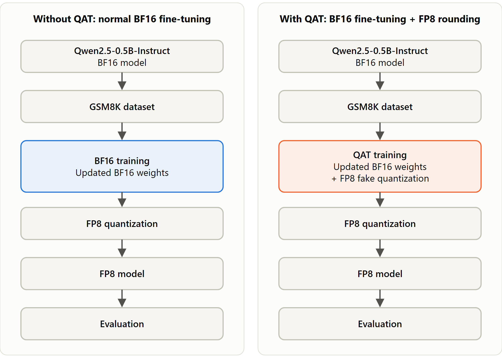
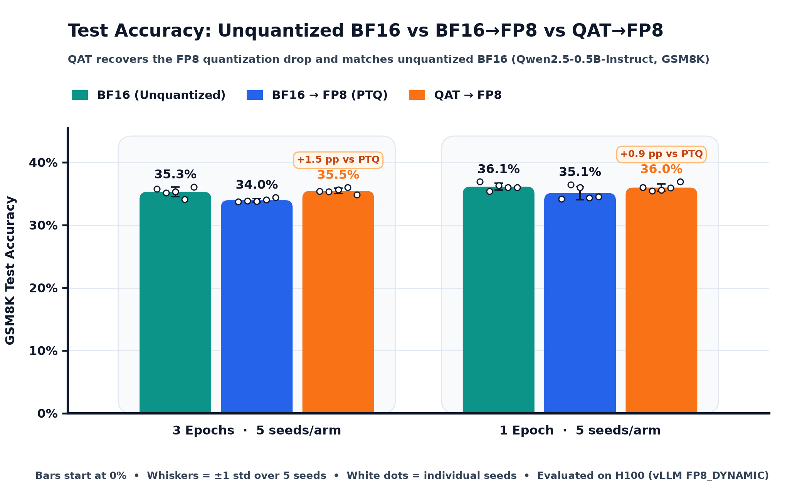
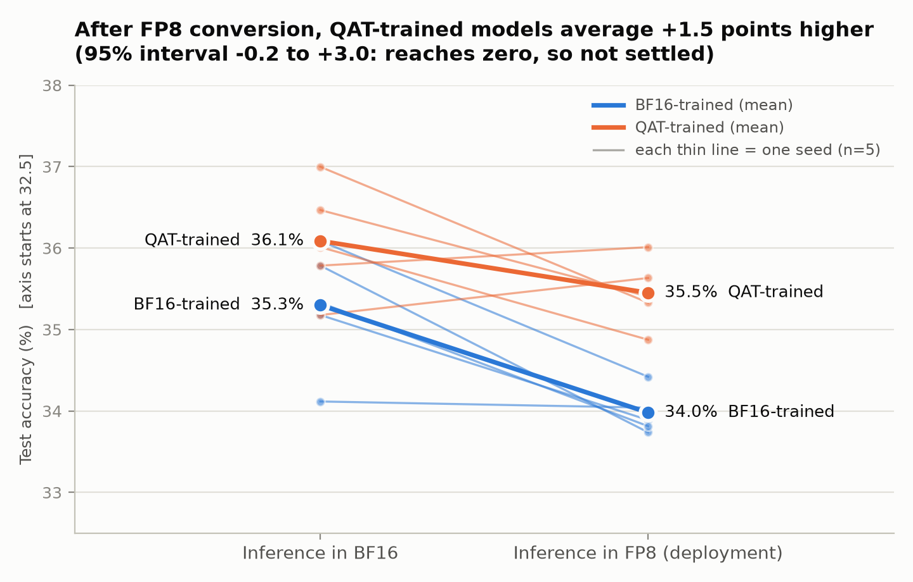
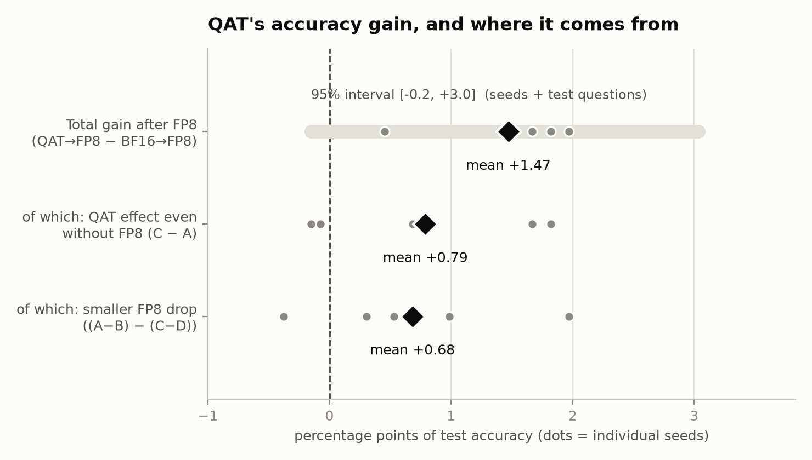
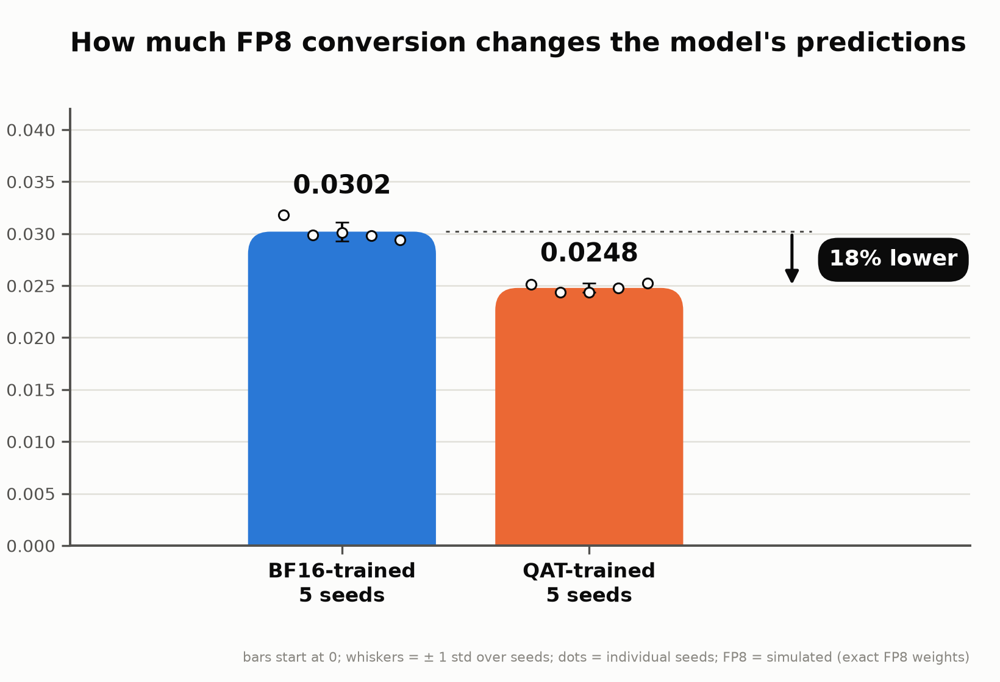
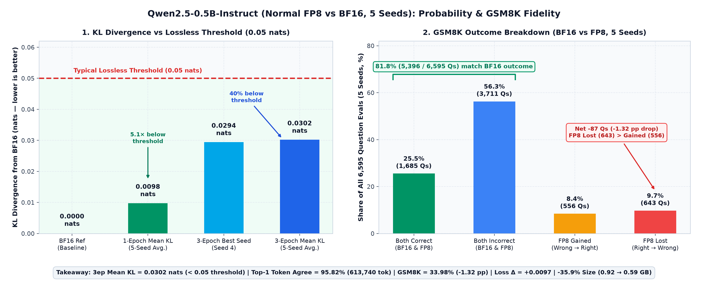
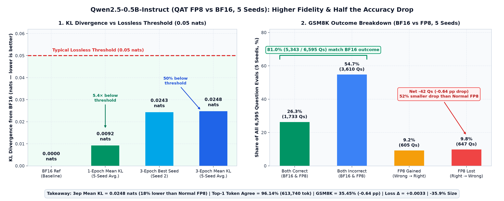
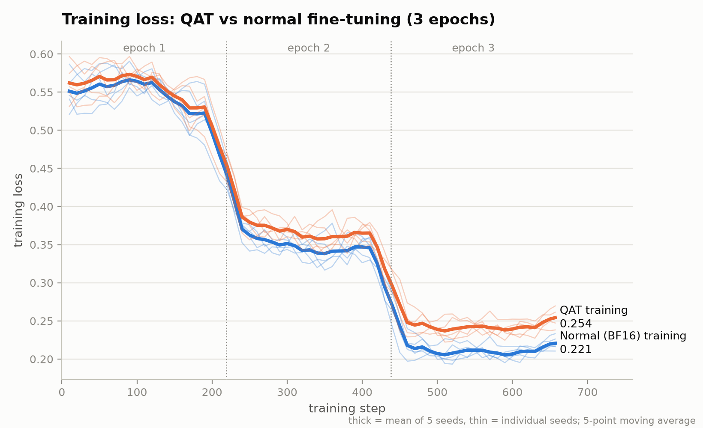
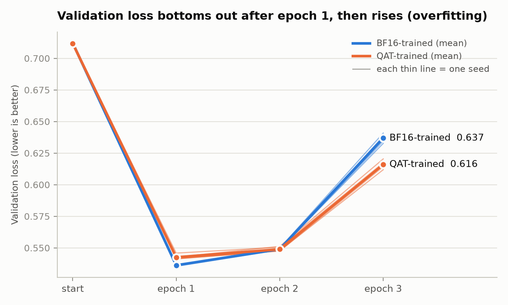
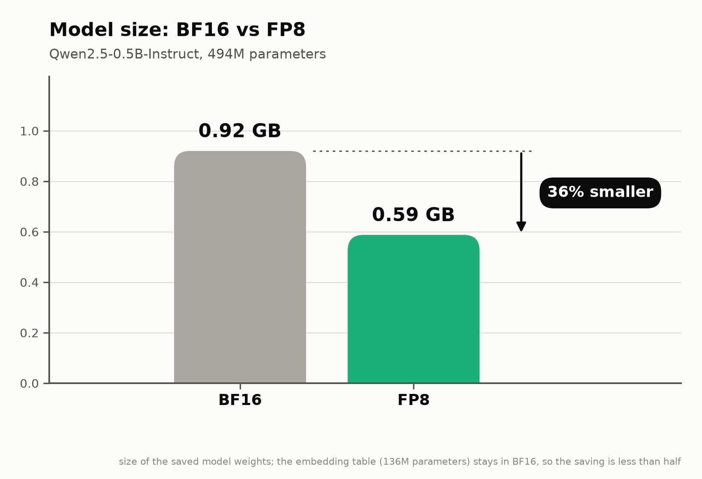

# FP8 Quantization-Aware Training (QAT) vs Standard BF16 Fine-Tuning

A controlled, multi-seed empirical study comparing **FP8 Quantization-Aware Training (QAT)** against standard **BF16 fine-tuning + Post-Training Quantization (PTQ)** for deploying LLMs in FP8 precision.

- **Model:** `Qwen/Qwen2.5-0.5B-Instruct` (494M parameters, full fine-tuning — no LoRA)
- **Dataset:** `openai/gsm8k` (7,000 train / 473 val / 1,319 test, fixed split)
- **Quantization Recipe:** FP8 E4M3 (`FP8_DYNAMIC` — per-channel static/dynamic weights, per-token dynamic activations) across all 168 linear projections
- **Hardware & Serving Stack:** NVIDIA H100 (`Modal`), `llm-compressor` for FP8 export, `vLLM` for inference evaluation
- **Statistical Rigor:** 5 random seeds per arm (`seeds 0–4`) across both **3-epoch** and **1-epoch** regimes

---

## Executive Summary

When deploying a fine-tuned model in **FP8** (which cuts checkpoint size by **36%**, from **0.92 GB** to **0.59 GB**), standard BF16 fine-tuning suffers a noticeable quantization accuracy drop (**−1.32 pp** at 3 epochs, **−1.02 pp** at 1 epoch). Training with FP8 fake quantization (QAT) recovers that loss:

| Regime (5 seeds/arm) | BF16 → BF16 (Unquantized) | BF16 → FP8 (PTQ) | QAT → FP8 | QAT Gain over PTQ (`D − B`) | FP8 KL Divergence (`↓` better) |
|---|---:|---:|---:|---:|---:|
| **3 Epochs** | `35.30 ± 0.75%` | `33.98 ± 0.27%` | **`35.45 ± 0.42%`** | **`+1.47 pp`** (5/5 seeds) | `0.03019` → **`0.02478`** (**−18%**) |
| **1 Epoch** | `36.13 ± 0.55%` | `35.12 ± 1.05%` | **`35.98 ± 0.57%`** | **`+0.86 pp`** (3/5 seeds) | `0.00976` → **`0.00925`** (**−5%**) |

**Key Takeaways:**
1. **QAT → FP8 matches unquantized BF16 accuracy** (`35.45%` vs `35.30%` at 3 epochs; `35.98%` vs `36.13%` at 1 epoch) while delivering a **36% smaller** FP8 deployment checkpoint.
2. **FP8 shifts QAT predictions less:** Token-level KL divergence `KL(P_BF16 || P_FP8)` is lower for QAT in **5 out of 5 seeds** in both regimes (**18% lower** at 3 epochs, **5% lower** at 1 epoch).
3. **Where the gain comes from:** At 3 epochs, roughly half of the `+1.47 pp` gain comes from a **smaller FP8 quantization drop** (`+0.68 pp`) and half from **QAT's regularization effect** (`+0.79 pp`, which helps even in plain BF16 as 3-epoch training overfits).
4. **Honest statistical framing:** While QAT beats PTQ in 5/5 seeds at 3 epochs (paired `t = 5.47`, worst QAT seed `34.87%` > best PTQ seed `34.42%`), the bootstrap 95% CI resampling both seeds and the 1,319 test questions is `[-0.15, +3.03] pp` (`[+0.29, +2.62] pp` resampling questions only).

---

## Experimental Architecture

Both arms share identical starting weights, data ordering (per seed), optimizer (`AdamW` with BF16 stochastic rounding, `lr = 1e-5`, effective batch size `32`), and export/serving pipeline. The **only** difference during training is FP8 E4M3 fake quantization (Straight-Through Estimator) on the 168 linear layers in the QAT arm.



---

## Visual Analysis & Results

### 1. Accuracy Comparison: Unquantized BF16 vs BF16→FP8 vs QAT→FP8

Comparing all three deployment options side-by-side shows that standard BF16→FP8 (PTQ) drops below the unquantized BF16 baseline, whereas QAT→FP8 restores full BF16 accuracy in both the 3-epoch and 1-epoch settings.



#### Full 2×2 Accuracy Matrix (3 Epochs, 5 Seeds)

| Training Arm | Inference Precision | Seed 0 | Seed 1 | Seed 2 | Seed 3 | Seed 4 | Mean ± Std | Eval Loss (`↓`) |
|---|---|---:|---:|---:|---:|---:|---:|---:|
| **BF16 Full** (`A`) | BF16 | 35.78% | 35.18% | 35.33% | 34.12% | 36.09% | `35.30 ± 0.75%` | `0.7462 ± 0.0014` |
| **BF16 Full** (`B`) | FP8 | 33.74% | 33.89% | 33.81% | 34.04% | 34.42% | `33.98 ± 0.27%` | `0.7558 ± 0.0046` |
| **QAT Full** (`C`) | BF16 | 36.47% | 37.00% | 35.18% | 35.78% | 36.01% | `36.09 ± 0.69%` | `0.7192 ± 0.0035` |
| **QAT Full** (`D`) | FP8 | 35.41% | 35.33% | 35.63% | 36.01% | 34.87% | **`35.45 ± 0.42%`** | **`0.7226 ± 0.0024`** |

*(Reference: Untrained `Qwen2.5-0.5B-Instruct` scores `39.95%` in BF16 on H100, and `38.74%` BF16 / `37.60%` FP8 on L4. Fine-tuning on short GSM8K human solutions slightly lowers overall accuracy for both arms, making this a clean testbed for quantization degradation rather than raw SFT uplift.)*

---

### 2. Per-Seed Trajectory & Gain Decomposition (3 Epochs)

Tracking every seed from BF16 inference to FP8 deployment shows a flatter quantization drop for QAT, and decomposing the `+1.47 pp` gain separates **pre-quantization regularization (`C − A`)** from **reduced FP8 drop (`(A − B) − (C − D)`)**:

| BF16 → FP8 Transition (5 Seeds) | Gain Breakdown |
|---|---|
|  |  |

---

### 3. Prediction Drift Under FP8: KL Divergence & Question-Level Fidelity

Because discrete GSM8K accuracy over 1,319 questions has high sampling variance (`±1.3 pp` per model), we also measure mean token-level `KL(P_BF16 || P_FP8)` across all answer tokens and question-level flip rates across all `5 × 1,319 = 6,595` evaluations. Lower KL means FP8 conversion alters the model's output distribution less.

- **3 epochs:** BF16-trained `0.03019 ± 0.00093` vs QAT-trained **`0.02478 ± 0.00043`** (**18% lower**, 5/5 seeds; top-1 agreement `95.82%` → `96.14%`)
- **1 epoch:** BF16-trained `0.00976 ± 0.00016` vs QAT-trained **`0.00925 ± 0.00015`** (**5% lower**, 5/5 seeds; top-1 agreement `97.24%` → `97.36%`)
- **Question-level net loss under FP8 (3 epochs, 6,595 total evals):** Normal BF16→FP8 loses a net **−87 questions** (`−1.32 pp`), whereas QAT→FP8 cuts that net loss in half to **−42 questions** (`−0.64 pp`, **52% smaller drop**).



#### Executive Fidelity Breakdown: Normal FP8 vs QAT FP8 (5 Seeds)

**Normal BF16-trained → FP8 (PTQ):**



**QAT-trained → FP8:**



---

### 4. Training Dynamics & Overfitting Analysis

Training logs (`results/runs/*/seed_*/train_log.jsonl`, logged every 10 steps across all 5 seeds) reveal why the 1-epoch experiment was added:
- **Training loss** decreases smoothly for both arms, with QAT staying slightly higher due to fake-quantization noise.
- **Validation loss** bottoms out at **epoch 1** (`~0.536` BF16 / `~0.543` QAT) and rises in epochs 2–3 (`0.637` BF16 / `0.616` QAT), confirming that 3 epochs overfit—and that QAT's quantization noise acts as a mild regularizer during overfitting.

| Training Loss (5 Seeds, Smoothed) | Validation Loss by Epoch |
|---|---|
|  |  |

---

### 5. Checkpoint Size: BF16 vs FP8

Quantizing the 168 linear projections to FP8 reduces the saved `.safetensors` checkpoint from **0.92 GB** to **0.59 GB** (**36% smaller**). The embedding table (136M parameters) remains in BF16, which is why the reduction is 36% rather than 50%. Both BF16→FP8 and QAT→FP8 produce the exact same FP8 checkpoint format and size.



---

## Repository Structure

```text
qat/
├── analysis/                  # Statistical analysis, reports, and plotting scripts
│   ├── bar_graph_3bars.py     # 3-bar accuracy comparison (BF16 vs BF16→FP8 vs QAT→FP8)
│   ├── bar_graph.py           # 2-bar FP8 accuracy comparison
│   ├── compare.py             # Paired t-test, McNemar, bootstrap CIs, CSV/MD report generator
│   ├── kl_executive_summary.py # KL threshold + GSM8K outcome breakdown executive summaries
│   ├── kl_graph.py            # KL divergence plots & summary table
│   ├── plots.py               # Slope graph, gain breakdown, and validation loss curves
│   ├── size_graph.py          # BF16 vs FP8 checkpoint size plot
│   └── train_loss_graph.py    # 5-seed smoothed training loss curves from train_log.jsonl
├── benchmarks/                # Throughput, latency, and checkpoint size benchmarks
├── common/                    # Config loader, deterministic seeding, environment reporting
├── configs/                   # YAML configs (base.yaml, bf16_full.yaml, qat_fp8.yaml, smoke.yaml)
├── data/                      # Fixed GSM8K train/val/test JSONL splits + SHA256 manifest
├── evaluation/                # vLLM accuracy evaluator, teacher-forced loss, KL divergence, FP8 checks
├── final_report/              # Exported PDF reports, HTML report, architecture diagram, and PPTX deck
├── models/                    # FP8 E4M3 fake-quantizer (STE) and llm-compressor FP8 exporter
├── more_seeds_added/          # 3-epoch (5-seed) reports, stats, CSV, and plots
├── plots_with_epochs/         # 1-epoch + combined comparison reports, KL results, and plots
├── results/                   # Raw per-seed JSON/JSONL evaluation outputs, benchmarks, and train logs
├── tests/                     # Unit tests (dataset, answer extraction, fake-quant, KL, optimizer, eval)
├── training/                  # Full fine-tuning loop & BF16 stochastic-rounding AdamW
├── modal_app.py               # Modal H100 orchestration (train, export, serve/eval, KL, benchmark)
└── requirements-local.txt     # Local Python dependencies for tests, analysis, and Modal CLI
```

### Full Reports & Presentation
- **Full Technical Report (PDF):** [`final_report/QAT_vs_BF16_FP8_report.pdf`](final_report/QAT_vs_BF16_FP8_report.pdf)
- **Executive Short Report (PDF):** [`final_report/QAT_FP8_short_report.pdf`](final_report/QAT_FP8_short_report.pdf)
- **Slide Deck (PPTX):** [`final_report/QAT_vs_BF16_FP8_presentation.pptx`](final_report/QAT_vs_BF16_FP8_presentation.pptx)

---

## Environment Setup & Reproduction

### 1. Local Environment (Python 3.11)

Create a Python 3.11 virtual environment for running unit tests, regenerating plots/reports, and launching Modal GPU jobs:

```powershell
# Create and activate a Python 3.11 virtual environment (Windows PowerShell)
py -3.11 -m venv venv
.\venv\Scripts\Activate.ps1

# Install local dependencies (CPU PyTorch + analysis/plotting + Modal CLI)
python -m pip install --upgrade pip
python -m pip install -r requirements-local.txt
```

*(On Linux/macOS: `python3.11 -m venv venv && source venv/bin/activate && pip install -r requirements-local.txt`.)*

### 2. Run Unit Tests

```powershell
pytest -v
```

### 3. Regenerate Analysis & Plots Locally

All raw evaluation JSONs, KL files, benchmarks, and training logs are included under `results/`, so every table and figure can be regenerated locally without a GPU:

```powershell
# 3-epoch (5 seeds) and 1-epoch (5 seeds) core plots & reports
python analysis/plots.py --out more_seeds_added --epochs 3
python analysis/plots.py --out plots_with_epochs --prefix 1ep_ --arm-suffix _1ep --epochs 1

# 3-bar accuracy comparison (BF16 unquantized vs BF16->FP8 vs QAT->FP8)
python analysis/bar_graph_3bars.py

# KL divergence, executive fidelity summaries, training loss, and model size plots
python analysis/kl_graph.py
python analysis/kl_executive_summary.py
python analysis/train_loss_graph.py
python analysis/size_graph.py
```

### 4. Re-run GPU Training, FP8 Export & Evaluation on Modal (H100)

The GPU pipeline uses three isolated Modal container images (`train_image` with PyTorch 2.15 + Transformers 5.23, `export_image` with `llmcompressor`, and `serve_image` with `vLLM`) to avoid dependency conflicts:

```powershell
modal setup
modal run modal_app.py::env_check        # Verify GPU + FP8 GEMM stack
modal run modal_app.py::prepare_volume   # Upload fixed GSM8K split & manifest
```

---

## Limitations

- **Single model size & dataset:** Tested on `Qwen2.5-0.5B-Instruct` and `GSM8K` (1,319 test questions); larger models or other tasks may exhibit different quantization sensitivity.
- **Sample size:** 5 seeds per arm (varying data order and rounding randomness from the same base checkpoint).
- **Hardware numerics:** Primary FP8 evaluations run on NVIDIA H100; GPU-level numerics alone can shift single-model GSM8K accuracy by ~1 pp (as seen in the H100 vs L4 baseline check).
- **Simulated vs deployed activations:** The QAT fake quantizer matches deployed FP8 weights bit-for-bit, while simulated activation quantization reproduces ~66–76% of the deployed FP8 loss delta.
